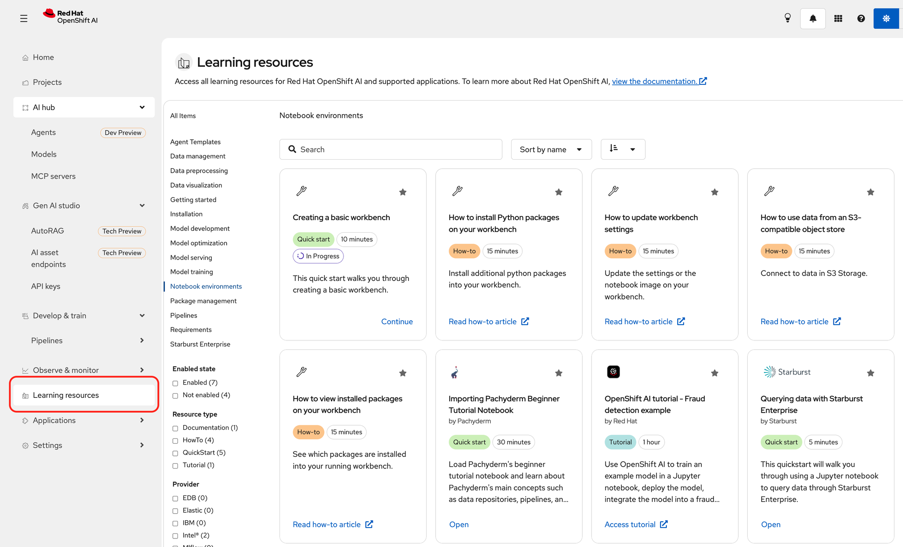

# Where should we point users to learn OpenShift AI?

**Applies to:** Red Hat OpenShift AI 3.5 Self-Managed.

## Start inside the product: the Learning resources page

Before sending anyone to the documentation portal, point them at the **Learning resources** page built into the OpenShift AI dashboard, in the left navigation below *Observe & monitor*. It's the lowest-friction starting point: one click from where users already are, filterable by workflow stage and content type, and it tracks progress so people can stop and resume.

Good first items for a new user: *Creating a basic workbench* (Quick start, 10 min), *How to install Python packages on your workbench* (How-to, 15 min), *How to use data from an S3-compatible object store* (How-to, 15 min), and the full *OpenShift AI tutorial – Fraud detection example* (Tutorial, 1 hour).

Note that enabled partner applications contribute their own entries here, so the page reflects what you have enabled on the cluster.

## Hands-on learning paths on Red Hat Developer

[**developers.redhat.com/learn/openshift-ai**](https://developers.redhat.com/learn/openshift-ai) is the best complement to the product documentation. The paths are short, task-shaped and written for people who want to build something rather than read a reference. A few worth highlighting:

| Learning path | Good for |
|---|---|
| [Introduction to OpenShift AI](https://developers.redhat.com/learn/openshift-ai/introduction-openshift-ai) | The single best entry point for someone who has never opened the product |
| [Automate an ML pipeline](https://developers.redhat.com/learn/openshift-ai/automate-ml-pipeline-openshift-ai) | Moving from notebook experiments to repeatable pipelines |
| [Get started with vLLM](https://developers.redhat.com/learn/openshift-ai/get-started-vllm) | Teams starting on LLM serving |
| [Demystify RAG with OpenShift AI and Elasticsearch](https://developers.redhat.com/learn/openshift-ai/demystify-rag-openshift-ai-and-elasticsearch) | A concrete RAG walkthrough |

The [**Developer Sandbox**](https://developers.redhat.com/developer-sandbox) is also worth knowing about — a free, no-setup shared cluster that includes OpenShift AI, useful for letting people try the product before you provision access on your own cluster. It runs an earlier release, so use it for familiarisation rather than for evaluating 3.5-specific features.

## Then the 3.5 documentation

The product documentation landing page is **https://docs.redhat.com/en/documentation/red_hat_openshift_ai_self-managed/3.5**. It publishes 39 guides, which is a lot to hand someone unfiltered, so we'd route by role and task instead.

**For a brand-new end user, in order:**

1. **[Getting started with Red Hat OpenShift AI Self-Managed](https://docs.redhat.com/en/documentation/red_hat_openshift_ai_self-managed/3.5/html/getting_started_with_red_hat_openshift_ai_self-managed/index)** — product overview and workflow diagram, glossary, log in, view installed components, create a project, create a workbench and choose an IDE. Roughly half an hour.
2. **[OpenShift AI tutorial – Fraud detection example](https://docs.redhat.com/en/documentation/red_hat_openshift_ai_self-managed/3.5/html/openshift_ai_tutorial_-_fraud_detection_example/index)** — the end-to-end hands-on tutorial: project and storage setup, workbenches, model deployment and testing, AI pipelines, distributed workloads and Feature Store. Needs access to your own cluster.

### By task — for end users

| What they want to do | Guide |
|---|---|
| Day-to-day project work | [Working on projects](https://docs.redhat.com/en/documentation/red_hat_openshift_ai_self-managed/3.5/html/working_on_projects/index) |
| Work in JupyterLab or code-server | [Working in your data science IDE](https://docs.redhat.com/en/documentation/red_hat_openshift_ai_self-managed/3.5/html/working_in_your_data_science_ide/index) |
| Deploy a model | [Deploying models](https://docs.redhat.com/en/documentation/red_hat_openshift_ai_self-managed/3.5/html/deploying_models/index) |
| Build and run pipelines | [Working with AI pipelines](https://docs.redhat.com/en/documentation/red_hat_openshift_ai_self-managed/3.5/html/working_with_ai_pipelines/index) |
| Register and version models | [Working with model registries](https://docs.redhat.com/en/documentation/red_hat_openshift_ai_self-managed/3.5/html/working_with_model_registries/index) |
| Discover and evaluate models | [Working with the model catalog](https://docs.redhat.com/en/documentation/red_hat_openshift_ai_self-managed/3.5/html/working_with_the_model_catalog/index) |
| Experiment with prompts and gen AI | [Experimenting with models in the gen AI playground](https://docs.redhat.com/en/documentation/red_hat_openshift_ai_self-managed/3.5/html/experimenting_with_models_in_the_gen_ai_playground/index) |
| Build a RAG application | [Building RAG applications with OGX](https://docs.redhat.com/en/documentation/red_hat_openshift_ai_self-managed/3.5/html/building_rag_applications_with_ogx/index) |
| Track experiments | [Working with MLflow](https://docs.redhat.com/en/documentation/red_hat_openshift_ai_self-managed/3.5/html/working_with_mlflow/index) |
| Use the Feature Store | [Working with machine learning features](https://docs.redhat.com/en/documentation/red_hat_openshift_ai_self-managed/3.5/html/working_with_machine_learning_features/index) |
| Run distributed training or compute | [Working with distributed workloads](https://docs.redhat.com/en/documentation/red_hat_openshift_ai_self-managed/3.5/html/working_with_distributed_workloads/index) |
| Evaluate model and system quality | [Evaluating AI systems](https://docs.redhat.com/en/documentation/red_hat_openshift_ai_self-managed/3.5/html/evaluating_ai_systems/index) |
| Work with MCP servers | [Working with the MCP catalog](https://docs.redhat.com/en/documentation/red_hat_openshift_ai_self-managed/3.5/html/working_with_the_mcp_catalog/index) |

### By task — for administrators

| What they want to do | Guide |
|---|---|
| Install the platform | [Installing and uninstalling OpenShift AI Self-Managed](https://docs.redhat.com/en/documentation/red_hat_openshift_ai_self-managed/3.5/html/installing_and_uninstalling_openshift_ai_self-managed/index) |
| Upgrade | [Upgrading OpenShift AI Self-Managed](https://docs.redhat.com/en/documentation/red_hat_openshift_ai_self-managed/3.5/html/upgrading_openshift_ai_self-managed/index) |
| Manage users and groups | [Managing OpenShift AI](https://docs.redhat.com/en/documentation/red_hat_openshift_ai_self-managed/3.5/html/managing_openshift_ai/managing-users-and-groups#overview-of-user-types-and-permissions_managing-rhoai) |
| Day-2 resource and dashboard management | [Managing resources](https://docs.redhat.com/en/documentation/red_hat_openshift_ai_self-managed/3.5/html/managing_resources/index) |
| Configure model serving | [Configuring your model-serving platform](https://docs.redhat.com/en/documentation/red_hat_openshift_ai_self-managed/3.5/html/configuring_your_model-serving_platform/index) |
| Create and govern workbenches | [Creating a workbench](https://docs.redhat.com/en/documentation/red_hat_openshift_ai_self-managed/3.5/html/creating_a_workbench/index) |
| Provision model registries | [Managing model registries](https://docs.redhat.com/en/documentation/red_hat_openshift_ai_self-managed/3.5/html/managing_model_registries/index) |
| Enable and manage GPUs | [Working with accelerators](https://docs.redhat.com/en/documentation/red_hat_openshift_ai_self-managed/3.5/html/working_with_accelerators/index) |
| Monitor and autoscale deployed models | [Managing and monitoring models](https://docs.redhat.com/en/documentation/red_hat_openshift_ai_self-managed/3.5/html/managing_and_monitoring_models/index) |
| Set up bias and drift monitoring | [Monitoring your AI systems](https://docs.redhat.com/en/documentation/red_hat_openshift_ai_self-managed/3.5/html/monitoring_your_ai_systems/index) |
| Enable content safety | [Enabling AI safety with Guardrails](https://docs.redhat.com/en/documentation/red_hat_openshift_ai_self-managed/3.5/html/enabling_ai_safety_with_guardrails/index) |
| Set up OGX | [Working with OGX](https://docs.redhat.com/en/documentation/red_hat_openshift_ai_self-managed/3.5/html/working_with_ogx/index) |
| Offer models as a service | [Govern LLM access with Models-as-a-Service](https://docs.redhat.com/en/documentation/red_hat_openshift_ai_self-managed/3.5/html/govern_llm_access_with_models-as-a-service/index) |
| Check versions and support status | [Release notes](https://docs.redhat.com/en/documentation/red_hat_openshift_ai_self-managed/3.5/html/release_notes/index) · [Supported Configurations](https://access.redhat.com/articles/rhoai-supported-configs) |

## One more resource

**[Red Hat AI quick starts](https://docs.redhat.com/en/learn/ai-quickstarts)** — use-case-driven onboarding paths, a good complement to the task-based guides above.
