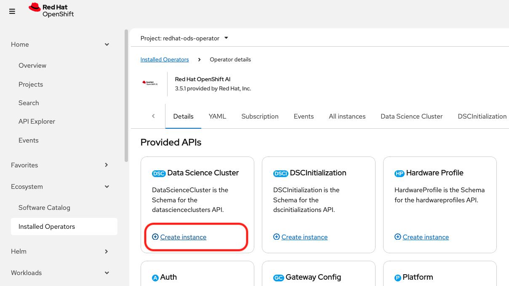

# Which components of OpenShift AI should we enable?

**Applies to:** Red Hat OpenShift AI 3.5 Self-Managed.

Red Hat does not publish a recommended component set. The right configuration depends on what the customer intend to do with the platform.

## Where the defaults come from

When you install the operator and click **Create instance** on the DataScienceCluster API, OpenShift pre-populates a DataScienceCluster CR. That sample ships inside the operator bundle, and it is the practical starting point for every console-driven install.

The table below shows the default CR from a RHOAI **3.5.1** install, with my comments on each setting.

## Component reference

| Component | Default | What it does | My comment |
|---|---|---|---|
| `dashboard` | `Managed` | The OpenShift AI web console. | Effectively mandatory, so we'd leave this on. Note that per-feature visibility is controlled separately in `OdhDashboardConfig` rather than here. |
| `workbenches` `workbenchNamespace: rhods-notebooks` | `Managed` | Jupyter and code-server development environments. | Worth keeping for any interactive development work. If you want a custom namespace, you need to create it *before* installing the operator. |
| `aipipelines` `argoWorkflowsControllers: Managed` | `Managed` | Pipelines for repeatable training and deployment workflows. | This needs write access to an S3-compatible bucket. If you already run your own Argo Workflows, set `argoWorkflowsControllers: Removed` so the two controllers don't conflict. |
| `kserve` | `Managed` | The model-serving platform, including vLLM-based LLM serving. | Worth keeping for any serving use case. It requires cert-manager, and if you ever set it to `Removed` you'll also need to disable the Service Mesh component. |
| `kserve.rawDeploymentServiceConfig` | `Headless` | Whether KServe creates headless Services for inference endpoints. | This is the most common thing to trip over. Both Guardrails and the Workload Variant Autoscaler require **`Headed`**, so if either is in scope it's worth setting from the start. |
| `kserve.nim` `airGapped: false` | `Managed` | NVIDIA NIM model serving. | On by default, but it won't work until you also set `disableNIMModelServing: false` and supply an NGC API key. If you don't use NIM, we'd set this to `Removed`. |
| `kserve.wva` | `Removed` | Workload Variant Autoscaler — traffic-aware autoscaling for llm-d. Technology Preview. | We'd leave this off unless you're adopting llm-d. It also needs `Headed` above, plus the Custom Metrics Autoscaler Operator. |
| `kserve.modelsAsService` | `Removed` | Deprecated. The original home of Models-as-a-Service. | This one is irreversible: once it's `Removed`, it can't be re-enabled. That's rarely a problem, since MaaS is now configured under `aigateway.modelsAsAService` instead. |
| `kserve.modelCache` | `Removed` | Caching layer for model artifacts. | We'd leave this off unless you have a repeated model-pull problem to solve. |
| `modelregistry` `registriesNamespace: rhoai-model-registries` | `Managed` | Register, version, govern and deploy models. | Worth keeping if governance matters to you. It requires an external MySQL (8.x recommended) and S3, which is the prerequisite people most often miss. Each registry has a single flat permission level, so teams are isolated by running separate instances rather than by roles. |
| `feastoperator` | `Managed` | Feature Store. Technology Preview. | Worth keeping if feature reuse is on your roadmap. The admin UI stays hidden until you set `featureStoreAdmin: true`. |
| `mlflowoperator` | `Managed` | Experiment tracking, model and prompt registry. | Enabling the component isn't quite enough — you also need to create an MLflow CR before you get a tracking server. |
| `trustyai` `mcpGuardrailsMode: false` `eval.lmeval.permitCodeExecution: deny` `eval.lmeval.permitOnline: deny` | `Managed` | Bias and drift monitoring, evaluation, and Guardrails. | The two `deny` values are a sensible security default, and we'd leave them alone unless you have a reviewed reason to change them. EvalHub stays hidden until `disableLMEval: false`, and the TrustyAI service only supports models served with OpenVINO Model Server. |
| `ray` | `Managed` | Ray clusters for distributed training and compute. | Worth keeping if you do any distributed work. It pairs with Kueue for scheduling. |
| `kueue` `autoCreateQueues: false` `defaultClusterQueueName: default` `defaultLocalQueueName: default` | `Removed` | Queuing, quota, preemption and gang scheduling, provided by the external Red Hat build of Kueue Operator. | `Managed` is rejected at runtime, so the real choice is between `Unmanaged` and `Removed`. `Removed` doesn't break Ray — you just lose quota, queuing and preemption, which is fine for a POC. For a shared or production GPU cluster we'd use `Unmanaged`. The queue fields only apply when it's `Unmanaged`, and the UI stays hidden until `disableKueue: false`. |
| `trainer` | `Managed` | Kubeflow Trainer v2 — the current distributed training engine. | This is the forward path for all fine-tuning. It needs the JobSet Operator, which isn't installed for you. We'd only turn it off if you're genuinely inference-only. |
| `trainingoperator` | `Removed` | Kubeflow Training Operator v1. | Deprecated, removed in 3.6, and excluded from 3.5 EUS (end-of-life 2027-03-27). We'd leave it off and use `trainer` instead. |
| `ogx` | `Managed` | Open GenAI Stack — inference, embeddings, vector storage and retrieval. Backs RAG, agents and the Gen AI Playground. Technology Preview. | Worth keeping if gen AI is in scope, though it's worth planning for the dependency footprint: OGX Operator, Service Mesh 3.x, cert-manager, Node Feature Discovery, NVIDIA GPU Operator, GPU nodes, S3 and PostgreSQL 14+. Note it's excluded from 3.5 EUS (end-of-life 2027-03-27). |
| `llamastackoperator` | `Removed` | Superseded by `ogx`. | We'd leave this off. |
| `aigateway` `modelsAsAService: Removed` `batchGateway: Removed` | `Removed` | Unified front door for model access: routing, authentication, rate limiting, monitoring. Hosts Models-as-a-Service. | Worth turning on when you want to offer models as an internal service with quotas and API keys. It has the heaviest prerequisite set in the product: Red Hat Connectivity Link, User Workload Monitoring, your own PostgreSQL 14+, and a Gateway API gateway. |
| `mcplifecycleoperator` | `Removed` | Deploys MCP servers from the AI hub MCP Catalog. Technology Preview, needs OpenShift 4.22+. | We'd leave this off unless you're doing agentic work. Enabling it alone does nothing visible — you also need to set `mcpCatalog: true`. |
| `sparkoperator` | `Removed` | Kubeflow Spark Operator for distributed data processing. | We'd leave this off unless you need Spark. It's also worth confirming the support level first: the supported-configurations matrix and the documentation disagree on whether it's GA or Developer Preview. |

## Enabling a component is sometimes only half the job

Setting a component to `Managed` makes its controller run, but it doesn't always make the feature visible in the dashboard. Visibility is controlled separately by the `OdhDashboardConfig` resource (`odh-dashboard-config` in `redhat-ods-applications`).

The pattern is easy to remember: **GA features default to visible, and Technology Preview features are opt-in, so they default to hidden.** These are the ones that will actually block you:

| Feature | Flag to set | Default |
|---|---|---|
| MCP Catalog | `mcpCatalog: true` | `false` |
| Kueue hardware profiles and queue UI | `disableKueue: false` | `true` |
| Feature Store admin UI | `featureStoreAdmin: true` | `false` |
| EvalHub evaluations | `disableLMEval: false` | `true` |
| Guardrails in the playground | `guardrails: true` | `false` |
| AutoRAG / AutoML | `autorag: true` / `automl: true` | `false` |
| External model endpoints | `externalModels: true` | `false` |

## Operator prerequisites

Several components depend on operators that OpenShift AI doesn't install for you, such as cert-manager, JobSet, Red Hat build of Kueue and Service Mesh 3.x. It's worth checking the [component requirements](https://docs.redhat.com/en/documentation/red_hat_openshift_ai_self-managed/3.5/html/installing_and_uninstalling_openshift_ai_self-managed_in_a_disconnected_environment/deploying-openshift-ai-in-a-disconnected-environment_install#component_requirements) before enabling anything new.

## Read more

- [Installing OpenShift AI components by using the OpenShift web console](https://docs.redhat.com/en/documentation/red_hat_openshift_ai_self-managed/3.5/html/installing_and_uninstalling_openshift_ai_self-managed/installing-and-deploying-openshift-ai_install#installing-openshift-ai-components-using-web-console_component-install) — the component list, with a description of each management state
- [Component requirements](https://docs.redhat.com/en/documentation/red_hat_openshift_ai_self-managed/3.5/html/installing_and_uninstalling_openshift_ai_self-managed_in_a_disconnected_environment/deploying-openshift-ai-in-a-disconnected-environment_install#component_requirements) — operator and external dependencies per component
- [Supported Configurations](https://access.redhat.com/articles/rhoai-supported-configs) — per-component GA / Technology Preview matrix
